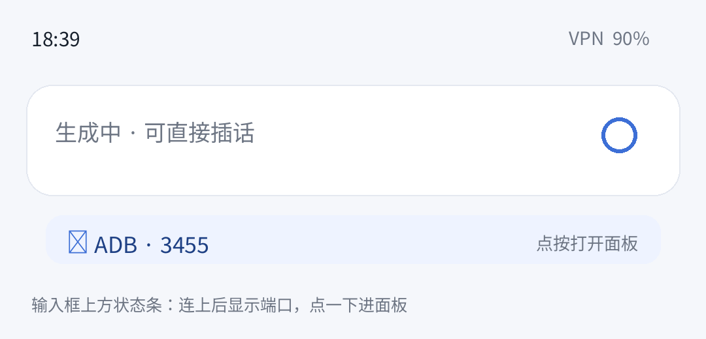
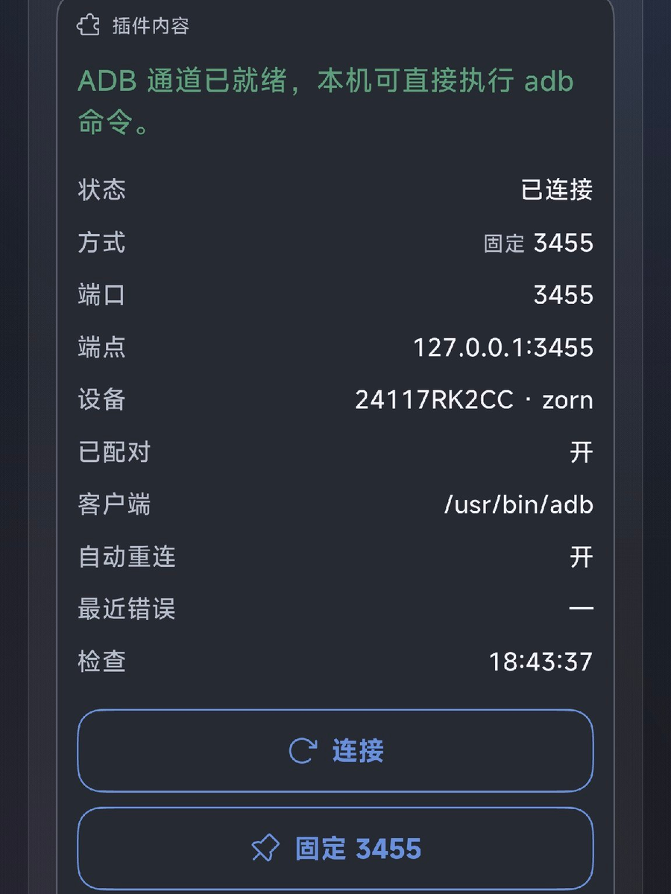
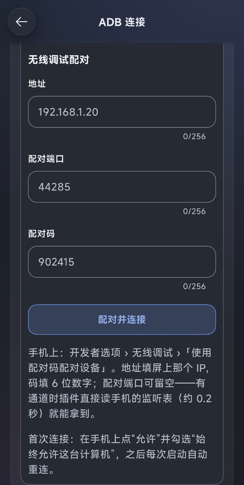

# dsh-go-adb-link

**二改自 [edgy7493/dsh-go-adb-link](https://github.com/edgy7493/dsh-go-adb-link)**（上游 1.2.4 · MIT）—— 逐项改动见 [NOTICE.md](NOTICE.md)。

**给 DSH Go 手机版装上一条不会掉线的 ADB 通道。**

[](package.json)
[](LICENSE)
[](#安装)
[](#它到底做了什么)

> ### 出处：这是二改
>
> 本仓库是 **[edgy7493/dsh-go-adb-link](https://github.com/edgy7493/dsh-go-adb-link)** 的**二改版（derivative work）**，不是原创。
> 上游版本 `1.2.4`，MIT，原作者 **edgy7493**；二改与后续维护 **usi112**。
> 逐项改动、以及为什么把版本重编号成 `0.1.x`，见 [NOTICE.md](NOTICE.md)。

> 在手机上让 AI 直接操作系统——截图、模拟点击、改 appops、读受保护数据、安装卸载 APK——前提是 `adb` 通。
> 这个插件把「找端口 → 连上 → 等授权 → 掉线重连」全部做完，并在输入框上方留一条状态条。
> 你现在看到的每一次 `adb shell`，背后都是它在维持。

---

## 一句话

Android 的 `adbd` 端口是随机的、重启会变；Android 11+ 原生「无线调试」更是 TLS，明文探测根本看不见。
DSH Go 的 Ubuntu 是免 root 的 proot，没有 USB，也不能 `setprop persist.adb.tcp.port`。
**结果是：想用 adb，就得每次都手动找端口。** 这个插件把那件事变成零。

## 长什么样

| 状态条 | 面板 | 无线调试配对 |
| --- | --- | --- |
|  |  |  |

> 以上是按插件真实视图 JSON 渲染的示意图（不是实机照片），布局、字段、按钮与 App 里一致；
> 机器可读清单在 [`screenshots.json`](screenshots.json)。

## 它到底做了什么

| 能力 | 做法 |
| --- | --- |
| **自动找端口** | 向候选端口发标准 ADB `CNXN` 握手包（纯 Node 实现，不需要 adb 客户端、不需要 root），只认回 `AUTH`/`CNXN` 的真 adbd；避开 TCP 自连与回显 |
| **自动重连** | 引擎启动、面板打开、轮询发现掉线时自动连；90 秒防抖，端口漂移时后台全端口重扫（限频 10 分钟） |
| **固定 3455** | 一键 `adb tcpip 3455`，让 adbd 改成明文 TCP 固定端口。之后掉线只剩一次 `adb connect 127.0.0.1:3455`，不用再扫 65535 个端口 |
| **无线调试配对** | 面板里填「地址 / 配对端口 / 6 位配对码」→ `adb pair` 成功后自动在高位端口段找连接端口，逐个 `adb connect` 验证（TLS 端口只能这样认） |
| **无线调试端口发现** | 有任意通道时直接读手机 `/proc/net/tcp*` 里 uid=2000（shell）的 LISTEN 端口——adbd 端口一览即得（**~180 ms**，配对面板开着时配对端口也在里面）；完全没通道才扫开放端口（~20 s），逐个 `adb connect` 验证 |
| **原生界面** | 输入框上方状态条（`ADB · 3455`）+ 面板：状态、方式、端口、端点、设备、已配对、客户端、自动重连、最近错误、检查时间 |
| **交给 AI** | 注册一个 `adb` 工具（参数结构化、自动确保连接、原生结果卡），并在系统提示里明确「系统级操作优先用 adb，不必先问」 |
| **不污染环境** | 运行记忆写在 `$DSH_HOME/dsh-go/adb-link/state.json`，不在包内，卸载/升级都不会带走或误发 |

## 装完没生效？先查这两处

`dsh plugin add` 正常会同时写 `dependencies` 和 `dsh.profile.bundles`，但**手动拷目录、或某些运行时版本**只写前者。
两处缺一，引擎的组合配置里就看不到插件，重启多少次都没用：

```sh
dsh --profile web --dump-config | grep -A1 dsh-go-adb-link-plus
# 有 `- id: dsh-go-adb-link-plus` 才算挂上；没输出就是没挂上
```

没挂上就补齐（路径换成你的）：

```sh
dsh plugin --profile web add "$DSH_HOME/dsh-go/plugins/dsh-go-adb-link-plus"
# 仍不写 bundles 时，手动把 dsh-go-adb-link-plus 加进 profiles/web/package.json 的 dsh.profile.bundles
# 然后 设置 › 引擎 › 重启引擎
```

另一处常见原因：`lib/` 代码改了**必须重启引擎**（清单 `package.json` 会自动重读，代码不会）。

## 安装

> **包名变更（0.2.0）**：从 `local-adb-quiet` 改名成 `dsh-go-adb-link-plus`，方便按名字搜到。
> 老用户重装一次即可：`dsh plugin --profile web remove local-adb-quiet` 然后按下面重新 `add`。
> 插件内部 id / `cordis.patch.yml` / `lib/index.js` 的 `name` 已同步，运行记忆（`$DSH_HOME/dsh-go/adb-link/`）不受影响。


前置：DSH Go App ≥ 1.0.11 · dsh 运行时 `>=0.2.1-rc.2 <0.3.0` · Node ≥ 22 · 手机侧已开 TCP 调试
（Stellar / Shizuku 的 TCP，或做过 `adb tcpip`）。

```sh
# 本地目录（开发用，改了代码热生效）
mkdir -p "$DSH_HOME/dsh-go/plugins"
git clone https://github.com/usi112/dsh-go-adb-link \
  "$DSH_HOME/dsh-go/plugins/dsh-go-adb-link-plus"
dsh plugin --profile web add "$DSH_HOME/dsh-go/plugins/dsh-go-adb-link-plus"

# 或者 tgz
dsh plugin --profile web add ./dsh-go-adb-link-plus-0.2.0.tgz
```

装完 `设置 › 引擎 › 重启引擎` 一次（清单会自动重读，`lib/` 代码不会）。状态条出现在输入框上方。

首次连接时手机会弹「允许 USB 调试吗」，点**允许**并勾**始终允许使用这台计算机**——只此一次。

## 三种情况怎么用（第一次装 / 第一次配对 / 重启之后）

### A. 第一次安装插件

```text
① 装：dsh plugin --profile web add <目录或 .tgz>
② 重启：设置 › 引擎 › 重启引擎   ← lib/ 代码必须重启才加载
③ 看：输入框上方出现状态条「ADB 未连接 · 点按」
④ 点「连接」：插件找端口 → adb connect → 手机弹「允许 USB 调试吗」
⑤ 在手机上勾「始终允许使用这台计算机」→ 允许   ← 只此一次
⑥ 状态条变成「ADB · 3455」→ bash 里 adb devices 能看到设备，AI 的 adb 工具也能用了
⑦ 立刻点一次「固定 3455」：以后掉线只需一次 connect，不用再扫 65535 个端口
```

前置：手机侧要有 TCP 调试入口 —— Stellar / Shizuku 的「TCP」开关，或已经 `adb tcpip` 过；
Android 11+ 也可以只开「无线调试」走下面的第一次配对流程。

### B. 第一次配对（Android 11+ 无线调试）

```text
① 手机：设置 › 开发者选项 › 无线调试（与 DSH 联同一个 Wi-Fi）
② 手机：无线调试页 ›「使用配对码配对设备」→ 屏上会出现 IP、配对端口、6 位配对码
③ 面板底部表单：地址填那个 IP；配对端口可留空；配对码填 6 位数字
④ 点「配对并连接」
⑤ 成功：提示「配对成功 · <端口>」，状态条变成「ADB · <端口>」
⑥ 再点「固定 3455」（可选但推荐）
```

要点：

- **配对码一次性**：面板每次打开都会换，填的时候别用旧的。
- **配对记录长期有效**：存在 `~/.android/adb_known_hosts.pb`，之后端口变了只要重连，不用再要码。
- **配对端口可以留空**：有任意 adb 通道时，插件直接读手机 `/proc/net/tcp*`（uid=2000 的 LISTEN 端口）0.2 秒拿到；
  完全没有通道时会扫开放端口（约 20 秒），再用 `adb pair` 逐个试——配对码只对真正的配对端口有效，试错不会配错设备。
- 无线调试关掉再开、或者重启手机，**端口会换**，但配对关系还在。

### C. 手机重启之后

事实：`adb tcpip 3455` 这个模式**重启就没了**（`persist.adb.tcp.port` 要 root，shell 改不动），
无线调试的端口也会重新分配。恢复顺序：

```text
① 打开无线调试（如果之前就是靠它连的）
② 面板点「扫描端口」，或直接「连接」
     · 有 3455 还活着 → 5 ms 命中（重启后一般不通）
     · 有旧配对记录 → TLS 通道能直接连，端口变了也一样（0.2 s ~ 20 s，取决于能不能读到设备监听表）
③ 连上后点一次「固定 3455」，把端口重新钉死
④ 验证：adb devices -l 出现 device；adb shell getprop service.adb.tcp.port 应为 3455
```

- 没有旧配对记录（换机、清过 `~/.android`）：先走 B 的配对流程。
- 引擎启动时插件会自己试记忆端口；`--watch` 守护（可选）会周期性保活并重连。

## 面板怎么用

```text
┌ 状态条：ADB · 3455 ─────────── 点按打开面板
│
│  状态    已连接        方式   固定 3455     端口 3455
│  端点    127.0.0.1:3455  设备 26048RP6AC · yili
│  已配对  开            客户端 /usr/bin/adb   最近错误 —
│
│  [ 连接 ]  [ 固定 3455 ]  [ 断开 ]
│  [ 扫描端口 ]  [ 复制命令 ]
│
│  无线调试配对
│    地址     ［192.168.1.20］
│    配对端口 ［留空也行］
│    配对码   ［902415］
│            [ 配对并连接 ]
└
```

按钮分工：

- **连接**：找端口 → `adb connect` → 等授权。找不到明文端口时会提示「无线调试是 TLS，用下面的配对表单」。
- **固定 3455**：对当前设备执行 `adb tcpip 3455`，等 adbd 在新端口应答，再重新 `adb connect`。**建议通道连通后先点它一次**，之后掉线恢复是毫秒级。
- **扫描端口**：先跑明文握手；没有结果就自动转 TLS 路径——开放端口扫描 → TLS 握手判定 → 逐个 `adb connect` 验证。
- **配对并连接**：给 Android 11+ 无线调试用。配对码一次性、面板每次打开都会换；配对记录存在 `~/.android/adb_known_hosts.pb`，**配对一次长期有效**。配对端口不知道填什么就**留空**。

## 速度（实测，本机 proot / Redmi 26048RP6AC / Android 16）

| 场景 | 耗时 | 说明 |
| --- | --- | --- |
| 已有通道，问设备要 adbd 端口 | **180 ms** | 读 `/proc/net/tcp*` 的 uid=2000 LISTEN 端口，得知 3455 与无线调试端口 |
| 端口没变（`state.tlsPort` 缓存） | **7–11 ms** | 上次的无线端口直接握手确认 |
| 明文候选（3455 / 5555 / 记忆端口） | **5 ms** | 发一个 `CNXN` 包 |
| 冷扫（无任何通道，32768–60999） | **19.5 s** | 开放端口扫描 28k 端口，finds 33027、46235，再由 `adb connect` 判定 |
| 经典 TCP 全端口扫描（65535） | 20–25 s | 只在完全没有线索时用 |

### 一个被实测推翻的假设（0.1.1–0.1.2 的错）

0.1.1/0.1.2 曾用「TLS 握手成功」来筛无线调试端口。**这个做法对 adbd 无效**：

- 安卓 11+ 无线调试用的是 **TLS-PSK**，密钥来自 SPAKE2 配对交换，普通 TLS 客户端拿不到 PSK；
- 实测：`adb connect 127.0.0.1:46235` 直接 `device`，而 `tls.connect` 同一个端口 100% 静默超时或 `ECONNRESET`；
- 结论：TLS 探测不能当过滤器，**唯一可信的判据是 `adb connect` + `adb devices`**；快速路径只能走设备侧套接字表。

0.1.3 已删掉 TLS 探测代码（`lib/adb.js` 留了一段说明原因的注释，避免后来人再踩）。

## 为什么是 3455，不是 5555

`5555` 是 adb 的模拟器约定端口：端口一开，`adb devices` 会自己冒出一条 `emulator-5554`，于是不带 `-s` 的 `adb shell` 直接报
`error: more than one device/emulator`。3455 是 Shizuku 生态常用的 TCP 端口，不和模拟器规则冲突，也是本插件的首选候选。

## 原理：三条路，一条比一条脏

**① 明文握手（经典 ADB over TCP）。** 发一个标准包：24 字节头
`command=CNXN | arg0=0x01000000 | arg1=262144 | length | crc32 | magic=^0xffffffff`，payload `host::\0`。
真 adbd 回 `AUTH`（要密钥）或 `CNXN`（`device::` banner）；HTTP、TLS、adb server 自己的 5037 都只会关连接。
两个必须排除的坑：内核把目标端口选成源端口的 **TCP 自连**，以及自连回显（banner 是 `host::`）。

**② 固定端口。** `adb tcpip 3455` 让 adbd 重启成 TCP 模式，端口号从此固定。
Android 官方把它当调试后门，但在自己手机上这是唯一能让「掉线=一次 connect」成立的办法。

**③ 无线调试。** 这条路对普通 ADB 明文握手完全不可见，而且**无线调试端口用的是 TLS-PSK**
（密钥由 SPAKE2 配对交换得出），所以连「发一个 TLS 握手看看」都不成立——实测 `adb connect` 能连上、
`tls.connect` 同一端口必定超时或 `ECONNRESET`。能用的只有两条：

- **有通道时问手机**：读 `/proc/net/tcp*` 里 uid=2000（shell）的 LISTEN 端口，adbd 的端口一览即得，约 180 ms；配对面板开着时配对端口也会出现。
- **完全没通道时扫描**：扫开放端口，把每个候选交给 `adb connect`，只有 `adb devices` 里的 `device` 算数（proot 里 `connect()` 会假成功，所以候选还要二次确认）。

连上之后，插件的 adb server（`127.0.0.1:5037`）与 bash 共用：插件相当于替 bash 执行了一次 `adb connect`。

## 给 AI 的部分

- 系统提示段插在 `TOOL_BASH` 之后：通道就绪时告诉模型「系统级操作主动用 adb」，
  通道用固定端口时还会补一句「手机重启后在面板点固定 3455」。
- `adb` 工具：`args` 原样传给 adb、不经过 shell；执行前若未连接会先自动连一次（最多 8 秒）；
  失败返回具体原因（`no-adb` / `no-port` / `unauthorized`）和下一步动作。
  结果在 App 里画成原生卡片（命令、设备、退出码、输出）。

## 已知限制

- `adb tcpip` 的模式**重启就没了**：`persist.adb.tcp.port` 需要 root，shell 身份被 SELinux 拒。
  恢复路径：开发者选项开无线调试 → 面板配对 → 再点「固定 3455」。
- 无线调试的**面板端口每次打开都会变**，配对码一次性。
- 只连本机（`127.0.0.1` 或本机 wlan 地址），不扫局域网、不连别的设备。
- 权限等于普通 `adb shell`（`uid=2000(shell)`），**不是 root**；不读剪贴板、输入框、对话内容。
- 只对 DSH Go 手机版（本机引擎）有意义：它必须能从手机自己的 Ubuntu 里连到本机 adbd。
- mDNS（`adb mdns services`）在 proot 里取不到广播，所以无线调试端口靠扫描 + TLS 判定，不靠 mDNS。

## 排障

| 现象 | 大概率原因 | 动作 |
| --- | --- | --- |
| 状态条「ADB 未连接」 | 端口变了 / TCP 服务没开 | 点「扫描端口」，或确认 Stellar 的 TCP 已开 |
| 全端口扫不到，但手机确实在调试 | 无线调试端口是 TLS-PSK，握手探测看不见 | 点「扫描端口」（有通道会读手机监听表，约 0.2 秒），或填配对表单（配对端口可留空） |
| 之前 `device`，突然 `Connection refused` | 端口轮换（实测 43955 → 35753 → 39763） | 重连即可；固定过 3455 的机器不会遇到 |
| 一直「待授权」 | 弹窗没点或没勾「始终允许」 | 点「连接」→ 手机上允许，10 分钟内不要反复触发 |
| 「缺 adb 客户端」 | 运行时升级清了 `/usr` | 点「连接」自动 `apt-get install -y adb` |
| `more than one device/emulator` | 用过 5555，留下 `emulator-5554` 幽灵 | `adb disconnect 127.0.0.1:5555`，改用 3455 |
| 装插件报版本不兼容 | dsh 不在 `0.2.1-rc.2 – 0.2.x` | 换运行时版本 |

更完整的流程、参数表与实测时间线见 [`docs/使用流程.md`](docs/使用流程.md)。

## 目录结构

```text
lib/index.js    清单处理、状态条与面板、连接 / 固定端口 / 配对、adb 工具、系统提示
lib/adb.js      纯 Node 端口发现：CNXN 握手、开放端口扫描、TLS 判定
lib/cli.js      adb 客户端调用：connect / disconnect / pair / tcpip / 装 adb
lib/state.js    运行记忆（$DSH_HOME/dsh-go/adb-link/state.json）
cordis.patch.yml  注册进 profile 的 patch 层
NOTICE.md        二改来源与逐项改动说明
docs/使用流程.md  完整流程说明
docs/img/*.png   状态条 / 面板 / 配对三张示意图
screenshots.json 市场卡片用的图片清单
```

## 开发

```sh
# 官方检查器：清单、视图、宿主侧加载
node "$DSH_HOME/skills/dsh-go-plugin/kit/bin/check.mjs" . --load

# 换机安装
dsh plugin --profile web add "$PWD"
```

`lib/` 改完要在 App 的 `设置 › 引擎` 重启引擎才生效；`package.json` 改动会自动重读。

## 来源与致谢

- **原项目**：[edgy7493/dsh-go-adb-link](https://github.com/edgy7493/dsh-go-adb-link) · MIT · 作者 **edgy7493**。
  本仓库基于它的 `1.2.4`：端口发现、自动重连、状态条 + 面板骨架、`adb` 工具与提示段都来自上游。
- **二改**：[usi112](https://github.com/usi112)：加了「固定 3455」、无线调试 TLS 配对、TLS 端口识别、
  面板字段扩展与断开逻辑修正，并把版本重编号为 `0.1.x`。
- 逐项对比见 [NOTICE.md](NOTICE.md)。

上游是 MIT 许可：欢迎再改再分发，保留 [LICENSE](LICENSE) 与 [NOTICE.md](NOTICE.md) 即可。

## License

[MIT](LICENSE)（沿用上游，原始版权声明保留）
